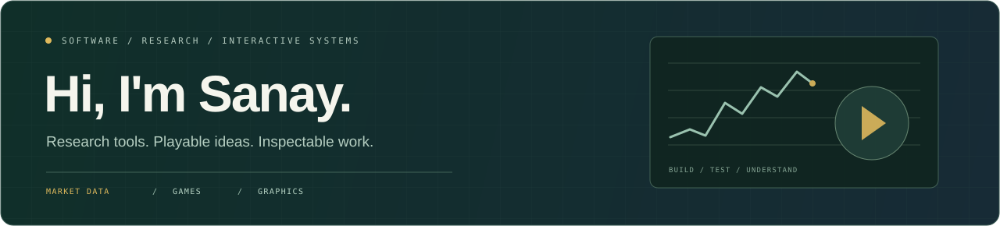

  

  <a href="https://pigheadedpeak16.github.io/btc-lab-v3/"><strong>Explore BTC LAB</strong></a>
  &nbsp;·&nbsp;
  <a href="https://pigheadedpeak16.github.io/stormvault-courier-alpha/"><strong>Play Stormvault Courier</strong></a>
  &nbsp;·&nbsp;
  <a href="https://github.com/pigheadedpeak16?tab=repositories">Browse my repositories</a>

## About me

I build projects to explore how systems work—from market-data research tools to browser games and computer graphics.

My current focus is turning ideas into software that people can run and inspect: clear interfaces, reproducible experiments, useful diagnostics, and honest explanations of what the results do and do not establish.

## Featured projects

### BTC LAB · Market research & strategy testing

A local Python workbench for researching BTC five-minute prediction markets. It connects market observations, configurable signals, causal replay, and realistic shadow execution in one inspectable workflow.

- **Seven configurable strategy families** with saved, immutable revisions, definition export, and archival history.
- **Causal replay:** keeps source, receipt, and processing timestamps distinct so later observations cannot silently become earlier evidence.
- **Execution constraints:** market expiry, delayed orders, book integrity, fees, minimum sizes, available depth, and partial fills.
- **A focused dashboard:** Live Data → Strategies → Results → Diagnostics, with saved reports and rejection reasons.
- **Verification:** 642 regression and integration tests passed on both Windows and Ubuntu for [release v0.5.9.5](https://github.com/pigheadedpeak16/btc-lab-v3/releases/tag/v0.5.9.5).
- **Reproducible entry point:** a clearly labeled synthetic example that runs without credentials or live collection.

**Built with:** Python · NumPy · Pydantic · SQLite · pytest · HTML/CSS/JavaScript · GitHub Actions

[Project website & setup](https://pigheadedpeak16.github.io/btc-lab-v3/) · [Source code](https://github.com/pigheadedpeak16/btc-lab-v3) · [Research method & evidence](https://github.com/pigheadedpeak16/btc-lab-v3/blob/main/docs/RESEARCH_NOTES.md) · [Architecture](https://github.com/pigheadedpeak16/btc-lab-v3/blob/main/docs/ARCHITECTURE.md)

> **Research, paper only.** The lab does not place real-money orders or establish that a strategy is profitable. Synthetic examples verify software behavior; they are not performance evidence.

### Stormvault Courier Alpha · Browser game

A playable browser-game prototype built around a salvage ship, hostile sectors, resource collection, and progression.

- Explore solar-system routes while managing increasing enemy pressure.
- Experiment with ship classes, temporary system upgrades, and permanent progression.
- Inspect enemy types and route themes through the codex and solar-system browser.
- Play with keyboard/mouse or the small-screen touch controls and Build drawer.
- Includes regression checks for progression and resource-balance behavior.

**Built with:** TypeScript · Phaser · Vite

[Play in your browser](https://pigheadedpeak16.github.io/stormvault-courier-alpha/) · [Source code](https://github.com/pigheadedpeak16/stormvault-courier-alpha) · [Controls & project notes](https://github.com/pigheadedpeak16/stormvault-courier-alpha#controls)

*An early alpha: additional tiers, mechanics, and content remain in development.*

## Tools in my projects

| Area | Languages, tools & concepts |
| --- | --- |
| Research & data | Python, NumPy, SQLite, causal observations, replay, execution modeling |
| Web & interfaces | TypeScript, JavaScript, HTML, CSS, Vite |
| Games | Phaser, Unity, C#, real-time interactions, progression systems |
| Computer graphics | WebGL, vectors and matrices, ray tracing, texturing, lighting, shadow mapping |
| Validation & delivery | pytest, regression checks, Git, GitHub Actions, GitHub Pages |

## What I'm exploring

- **Research systems:** how data quality, timing, and execution assumptions affect the conclusions an experiment can support.
- **Interactive software:** how controls, feedback, interfaces, and progression work together in a usable prototype.
- **Graphics foundations:** the mathematics and rendering techniques behind what appears on screen.
- **Reproducibility:** making a project understandable through examples, tests, documentation, and inspectable output.

## Coursework & foundations

| Repository | Focus |
| --- | --- |
| [CST 325 · Computer graphics](https://github.com/pigheadedpeak16/CST-325-Section-SANAY-JOG) | Particle systems, vector/matrix work, ray tracing, WebGL, textures, Phong lighting, and shadow mapping |
| [CST 326 · Game development](https://github.com/pigheadedpeak16/CST-326-Section-SANAY-JOG) | Unity/C# coursework, including Pong, platformer, Plinko, roll-a-ball, and shoot-em-up projects |

These repositories show the exercises and foundations alongside my independent projects.

## How I approach a project

1. **Make the idea concrete.** Build something that can be run or played.
2. **Make the behavior inspectable.** Keep useful diagnostics, outputs, and failure reasons visible.
3. **Test the assumptions.** Check edge cases and preserve regression evidence.
4. **Document the limits.** Separate a working implementation from a claim that still needs evidence.

---

  <strong>Want to explore a project?</strong> 
  Start with the live demo or README, then look through the source and tests.  
  <a href="https://github.com/pigheadedpeak16">GitHub</a>
  &nbsp;·&nbsp;
  <a href="https://github.com/pigheadedpeak16/btc-lab-v3/issues">BTC LAB issues</a>
  &nbsp;·&nbsp;
  <a href="https://github.com/pigheadedpeak16/stormvault-courier-alpha/issues">Stormvault issues</a>

