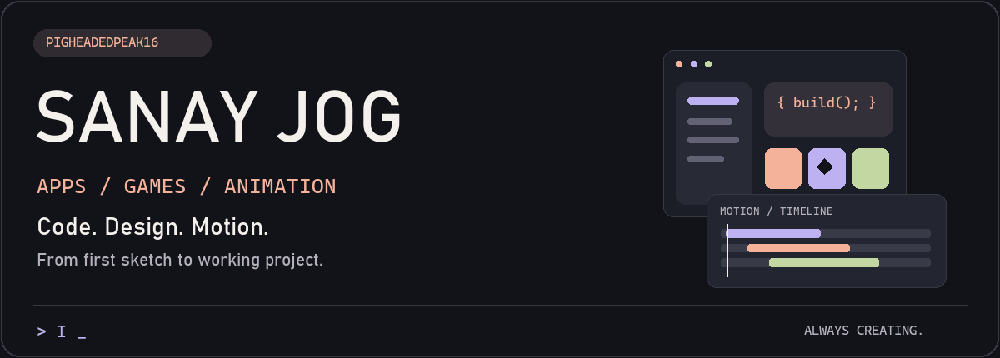
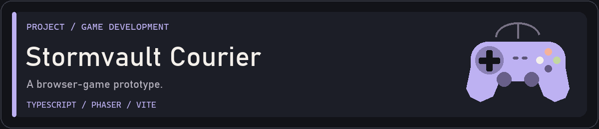
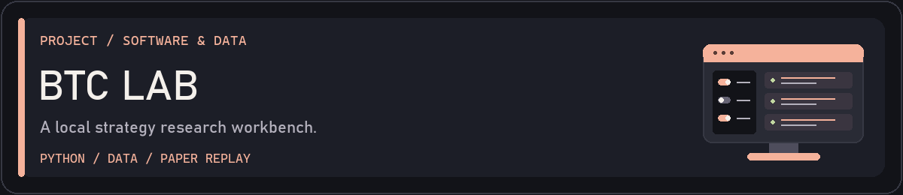
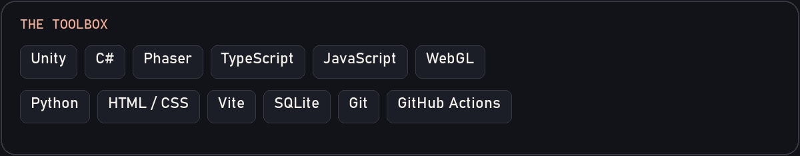
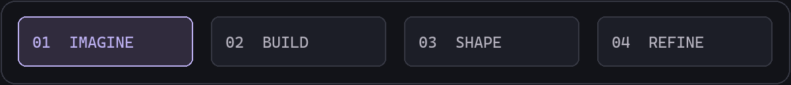

  <picture>
  <source media="(max-width: 600px)" srcset="assets/intro-mobile-animated.gif">
  
  </picture>

<a href="assets/intro-static.png">View a still version of the header</a>

  <a href="https://github.com/pigheadedpeak16?tab=repositories"><b>MY PROJECTS ↗</b></a>
  &nbsp;&nbsp; / &nbsp;&nbsp;
  <a href="https://www.instagram.com/pigheadedpeak/"><b>ART & ANIMATION ↗</b></a>
  &nbsp;&nbsp; / &nbsp;&nbsp;
  <a href="https://www.linkedin.com/in/sanay-jog-b24098280/"><b>LET'S CONNECT ↗</b></a>

 

## A little code. A little art. A lot of iteration.

Hey, I'm **Sanay** — I build **apps**, make **games**, and create **animations**. I also work on art, editing, and graphic design.

I like moving between the technical and creative sides of a project: building a gameplay system, shaping an interface, adjusting the timing of an animation, then trying it all again. The details matter to me — how something responds, what it communicates, and whether it feels good to use.

**My sweet spot:** programming that you can see, interact with, and play.

 

## A few of my projects

Pilot a salvage ship through hostile sectors, collect resources, and decide when to push further or head back. **Stormvault Courier** brings together gameplay programming, progression balancing, interface design, and game feel.

- **Explore & survive:** solar-system routes, rising enemy pressure, and an enemy codex.
- **Build your ship:** class branches, upgrades for the current run, and permanent progression.
- **Play your way:** keyboard/mouse and small-screen touch controls.

*Playable alpha — more ship tiers, mechanics, and content are still in development.*

**[Play in your browser →](https://pigheadedpeak16.github.io/stormvault-courier-alpha/)** &nbsp; · &nbsp; [Source code](https://github.com/pigheadedpeak16/stormvault-courier-alpha) &nbsp; · &nbsp; [Controls](https://github.com/pigheadedpeak16/stormvault-courier-alpha#controls)

 

A local research workbench for BTC five-minute prediction markets. **BTC LAB** focuses on inspectable experiments: where the data came from, which strategy version ran, and what the supplied order book allowed.

- **Configure:** seven strategy families with saved strategy revisions.
- **Replay:** historical observations with timing, fee, expiry, and liquidity checks.
- **Inspect:** Live Data, Strategies, Results, and Diagnostics views.

*Paper-only research software; it does not place real-money orders or establish profitable returns.*

**[Explore the project →](https://pigheadedpeak16.github.io/btc-lab-v3/)** &nbsp; · &nbsp; [Source code](https://github.com/pigheadedpeak16/btc-lab-v3) &nbsp; · &nbsp; [Research notes](https://github.com/pigheadedpeak16/btc-lab-v3/blob/main/docs/RESEARCH_NOTES.md)

 

## Where code meets creativity

| I build | I care about |
| :--- | :--- |
| **Games & interactive experiences** | Controls, feedback, progression, and that “one more try” feeling. |
| **Apps & useful software** | Clear interfaces, practical workflows, and systems you can inspect. |
| **Art & graphic design** | Composition, visual personality, and making an idea read clearly. |
| **Animation & editing** | Motion, timing, rhythm, and the details that bring a scene to life. |
| **Graphics & creative coding** | Turning vectors, lighting, textures, and mathematics into something visible. |

[See my art & animation on Instagram →](https://www.instagram.com/pigheadedpeak/)

 

## Tools behind the work

<picture>
  <source media="(max-width: 600px)" srcset="assets/toolkit-mobile.png">
  
</picture>

**Also in my projects:** NumPy, Pydantic, pytest, and GitHub Pages.

<b>The computer science behind the pixels</b>

 

| Repository | What I've worked on |
| :--- | :--- |
| [CST 325 · Computer graphics](https://github.com/pigheadedpeak16/CST-325-Section-SANAY-JOG) | Particle systems, vector and matrix math, ray tracing, WebGL, textures, Phong lighting, and shadow mapping. |
| [CST 326 · Game development](https://github.com/pigheadedpeak16/CST-326-Section-SANAY-JOG) | Unity and C# coursework, including Pong, platformer, Plinko, roll-a-ball, and shoot-em-up projects. |

 

## How I like to build

<picture>
  <source media="(max-width: 600px)" srcset="assets/workflow-mobile.gif">
  
</picture>

Start with an idea. Make it interactive. Give it a visual identity. Play, test, and keep refining.

I'm especially interested in **game feel**, **visual storytelling**, **computer graphics**, and the point where a technical decision becomes a creative one.

 

---

  <b>Have something interesting in mind?</b> 
  Games, creative tools, visual experiments — let's connect.

  <a href="https://www.linkedin.com/in/sanay-jog-b24098280/">LinkedIn</a>
  &nbsp; / &nbsp;
  <a href="https://www.instagram.com/pigheadedpeak/">Instagram</a>
  &nbsp; / &nbsp;
  <a href="https://github.com/pigheadedpeak16?tab=repositories">All repositories</a>

